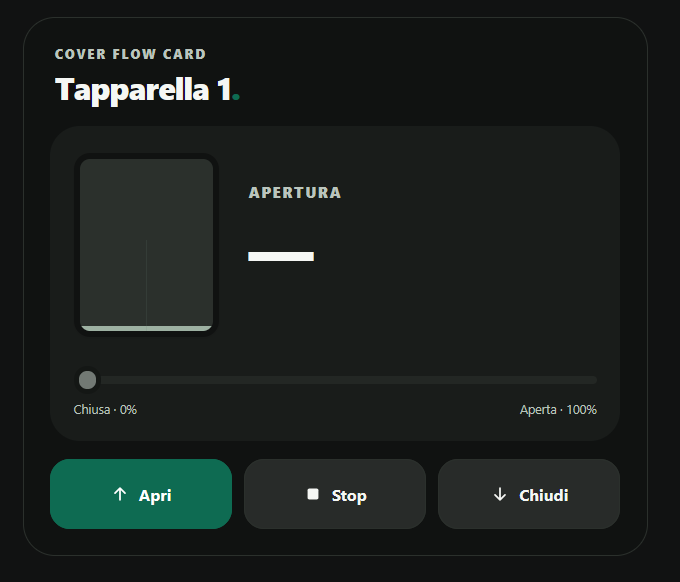

# Cover Flow Card

## Overview

**Cover Flow Card** is a custom Home Assistant dashboard card for controlling multiple cover entities through an elegant, minimalist, and responsive interface inspired by Edera Light and Graphite Dark.

Each cover has an individual position slider, graphical shutter visualization, opening percentage when available, and dedicated Open, Stop, and Close controls.

The card uses existing Home Assistant cover entities and requires no dedicated account, subscription, paid API, or external JavaScript library.

## Preview

## Features

- **Multiple covers:** Manage up to 24 cover entities within a single card.
- **Independent controls:** Open, stop, and close each supported cover individually.
- **Position slider:** Set the desired opening percentage from 0% to 100% when supported.
- **Dynamic shutter visualization:** Reflect the opening position reported by the device.
- **Device states:** Display available position and movement information without inventing values for unknown positions.
- **Capability-aware controls:** Enable only commands supported by the selected entity, including when the position is unknown.
- **Visual configuration:** Add, rename, reorder, and remove covers using the Home Assistant card editor.
- **Responsive layout:** Adaptive grid for smartphones, tablets, and desktop dashboards.
- **Edera appearance:** Automatic, Light, and Graphite Dark display modes.

Position percentages are displayed only when provided by the cover entity. Unsupported controls are disabled, and unknown or unavailable states are not represented as confirmed positions.

## Installation

### HACS

1. Open HACS in Home Assistant.
2. Open the three-dot menu and select **Custom repositories**.
3. Enter `https://github.com/luigi-regolo/cover-flow-card`.
4. Select **Dashboard** as the repository type and add it.
5. Open **Cover Flow Card** in HACS and select **Download**.
6. Reload the Home Assistant dashboard if necessary.
7. Add **Cover Flow Card** to your dashboard and configure it through the visual editor.

### Manual installation

1. Download `dist/cover-flow-card.js` from this repository.
2. Copy the JavaScript file into the `www` directory of your Home Assistant configuration.
3. Open Home Assistant dashboard resource management.
4. Add `/local/cover-flow-card.js` as a **JavaScript module**.
5. Reload the dashboard and add the custom card.

## Configuration / Usage

### Visual editor

Open a dashboard in edit mode, add **Cover Flow Card**, and configure the available options:

- **Covers:** Select cover entities, customize their displayed names, and reorder or remove them.
- **Appearance:** Customize the title, upper heading, and choose Automatic, Light, or Graphite Dark mode.
- **Advanced:** Review information about supported cover commands and position control.

For a single cover, a customized card title can be used unless an individual cover name is configured. With multiple covers, each item displays its configured name or Home Assistant friendly name.

The editor uses the native Home Assistant entity selector when available. No YAML is required for normal configuration.

### Cover controls

Each configured cover displays:

- **Opening percentage:** The position reported by Home Assistant, from 0% closed to 100% open.
- **Position slider:** Adjust the desired position when the entity supports position control and reports a valid position.
- **Open / Stop / Close:** Send the corresponding Home Assistant cover commands when supported.
- **Visual shutter:** Reflect the position reported by the entity.

The slider sends the selected position when released rather than sending continuous commands while dragging.

When a cover does not report its position, the percentage and slider are unavailable, while supported Open, Stop, and Close commands remain accessible.

## Compatibility / Requirements

Cover Flow Card requires Home Assistant with support for custom JavaScript dashboard cards and compatible `cover` entities.

Position control requires the `SET_POSITION` feature and a valid `current_position` attribute. The Open, Close, and Stop buttons depend on the corresponding supported features of each cover.

No specific minimum Home Assistant version has been independently verified.

The card does not require installation of the Edera theme or additional frontend libraries. HACS is required only when using the HACS installation method.

## Releases

Official versions and release notes are available on
[GitHub Releases](https://github.com/luigi-regolo/cover-flow-card/releases).

## Copyright & License

Copyright © 2026 luigi-regolo

Original project created and maintained by luigi-regolo.

Licensed under the **GNU General Public License, version 3 only (GPL-3.0-only)**. See [LICENSE](LICENSE) for the complete license terms.
